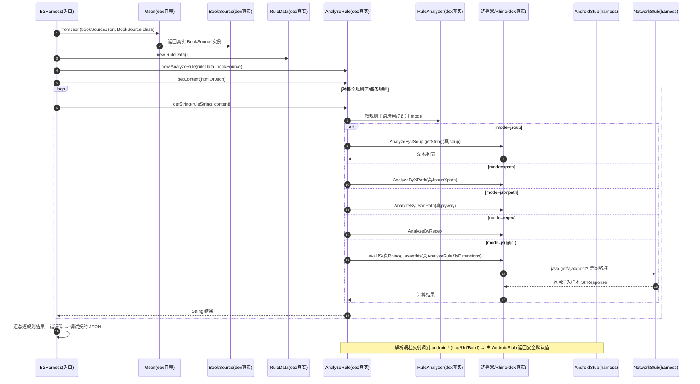
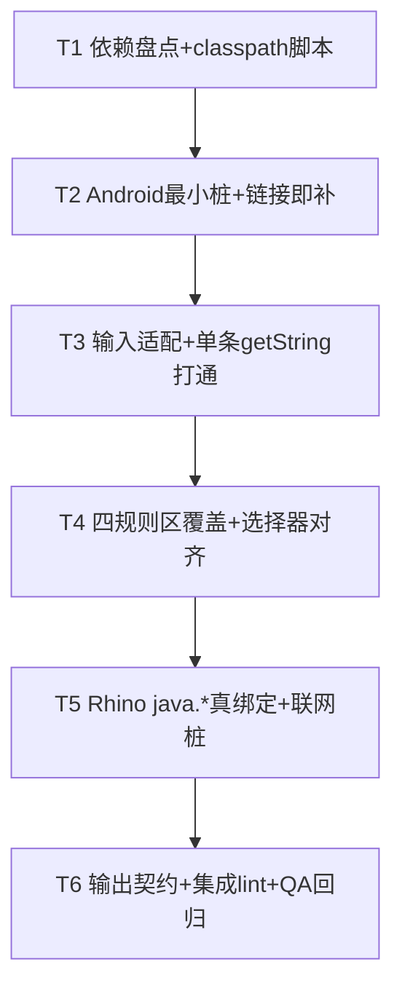

# B2 真机解析引擎 JVM harness —— 实现方案设计 + 任务分解

> 文档角色：架构师（高见远 / Bob）产出，作为工程师（寇豆码）的实现输入。
> 配套取证：`b2-feasibility.md`（可行性）、本设计所有"类已确认/MISSING"结论均来自 `javap` + `unzip -l` 实提（见附录 C）。
> 环境：OpenJDK 20 (Zulu/SDKMAN)；`javac`/`javap` 可用；`unzip` 可用；4 个 legado jar 已就位 `/workspace/b2-work/`；dex2jar 2.4 已就位 `/workspace/dex-tools-v2.4/`。
>
> **设计红线（务必遵守）**
> 1. **绝不真实联网**：任何 `java.get/ajax/post`、`AnalyzeUrl` 网络分支一律短路返回注入样本，禁止任何真实 HTTP。
> 2. **严禁引入外部 Rhino / 外部 jsoup / 外部选择器 jar**：dex 内已自带 `org.mozilla.javascript`（Rhino）、`org.jsoup`、`org.seimicrawler.xpath`、`com.jayway.jsonpath`、`com.google.gson`、`okhttp3`、`cn.hutool`、`kotlin.*`。外部版本会与 dex 混淆引用错配，直接导致链接/行为偏离真机。
> 3. **只加载解析子系统 + 其传递闭包**，不加载 APK 全量（UI/WebView 渲染等不触碰）。

---

## 0. 术语纠偏（先读，避免工程师走偏）

| 背景原表述 | 实测事实 | 纠正 |
|---|---|---|
| "解析入口 `AnalyzeRule.getString(...)` 两参重载，`mask=4`" | `javap` 显示公共重载为 `getString(String)` / `getString(String,Object)` / `getString(String,Object,boolean isUrl)` / `getString(List<SourceRule>...)`。**无任何 `mask` 形参** | `mask` 不是入参。模式由 `RuleAnalyzer` 按规则串语法自动识别（`##`→regex-replace、`//`→xpath、`@js:`→js、`$`→jsonpath、默认→jsoup）。"mask=4" 是"第 4 规则区=content"与"`AnalyzeRule$Mode.JSOUP=4`"的混淆。harness 调用 `getString(rule, content)` 即可 |
| "选择器层（真机级）需引入 jsoup-1.17.2.jar / JsoupXpath 2.5.5 / jayway" | 4 个 legado jar 内已打包 `org.jsoup(276)`、`org.seimicrawler.xpath(97)`、`com.jayway.jsonpath(221)` | **直接用 dex 自带版本**，版本与真机编译态一致；`/workspace/booksource_lint_assets/` 下的同类 jar 仅作"万一某类缺失"的兜底，默认不上 classpath |
| "Rhino 需确认 JVM 下能否直接用" | `org.mozilla.javascript` 在 4 jar 内共 **577** 个类条目（含混淆子类），随 jar 免费 | 直接用 dex 自带 Rhino 作为 `ScriptEngine`，**不**引入 `org.mozilla:rhino` 外部包 |

---

## 1. B2 harness 总体架构

### 1.1 设计目标
在**纯 JVM（OpenJDK 20，无 Android Runtime）**加载 APK **真实** `AnalyzeRule` 编排类及其真实选择器/Rhino 闭包，桩接 Android 框架与网络层，喂入"书源 JSON + 抓回的样本页面"，驱动真实 `AnalyzeRule.getString(...)` 跑出与真机逐规则一致的解析结果，并以调试接口（JSON 契约）暴露给 lint 工具/调试器。

### 1.2 分层架构图

```
┌──────────────────────────────── B2 harness (OpenJDK 20, 单 flat classpath) ────────────────────────────────┐
│                                                                                                              │
│  ┌─────────────────────────┐     书源JSON + 样本HTML/JSON      ┌────────────────────────────────────────┐   │
│  │  ① 输入适配层 (harness) │ ───────────────────────────────► │  ② 真实 dex 类 (classes*.jar, 自包含)   │   │
│  │  Gson→BookSource        │   （dex 自带 gson 反序列化）      │   • AnalyzeRule (编排核心)              │   │
│  │  setContent(html/json)  │                                   │   • AnalyzeByJSoup / AnalyzeByXPath /  │   │
│  └─────────────────────────┘                                   │     AnalyzeByJSonPath / AnalyzeByRegex │   │
│           │ 复用 lint 静态层(规则区划分/错误码)                  │   • BookSource / RuleData / 规则实体   │   │
│           ▼                                                    │   • 随包 Rhino(org.mozilla.js*)        │   │
│  ┌─────────────────────────┐                                   │   • 随包 jsoup/JsoupXpath/jayway/      │   │
│  │  ③ 执行编排 (harness)    │ ── new AnalyzeRule(ruleData,src)─►│     gson/hutool/okhttp3/kotlin         │   │
│  │  ar.getString(rule,ct)  │ ◄──── 真实 String 结果 ────────── │                                        │   │
│  └─────────────────────────┘                                   └───────────────┬────────────────────────┘   │
│           │                                                             真实选择器/Rhino 求值                  │
│           ▼                                                    ┌────────────────────────────────────────┐   │
│  ┌─────────────────────────┐                                   │  ④ 选择器/Rhino 引擎 (dex 自带, 真实)  │   │
│  │  ⑤ 输出适配层 (harness)  │ ◄──── 逐规则文本/列表 ──────────── │   jsoup 1.17.2 / JsoupXpath / jayway / │   │
│  │  逐规则结果 + 错误码     │                                   │   Rhino(真 evalJS, java=真AnalyzeRule)│   │
│  │  → 调试契约 JSON         │                                   └────────────────────────────────────────┘   │
│  └─────────────────────────┘                                            ▲                  ▲                  │
│           ▲                                                  ┌──────────┴──────────┐ ┌──────┴─────────┐      │
│           │ 桩拦截                                            │ ⑥ Android 桩        │ │ ⑦ 网络桩        │      │
│           └──────────────────────────────────────────────────│ android-stub.jar    │ │ (harness 硬短路)│      │
│                                                              │ Log/Uri/Build/      │ │ 返回注入样本    │      │
│                                                              │ Context/...         │ │ StrResponse     │      │
│                                                              └─────────────────────┘ └─────────────────┘      │
└──────────────────────────────────────────────────────────────────────────────────────────────────────────────┘
```

### 1.3 关键事实（已实证）
- `AnalyzeRule` 构造器：`AnalyzeRule(RuleDataInterface, BaseSource)` 与无参 `AnalyzeRule()`（见 1.4）。
- `RuleData`：具体 `final class`，无参构造，实现 `RuleDataInterface`（4 方法）。**直接用真实 `RuleData`，无需桩**。
- `BookSource`：具体类（位于 classes3.jar），有**无参构造器 + 28 参全参构造器**，是 `BaseSource` 的子类。**直接用真实 `BookSource`**（Gson 反序列化）。
- 选择器与 Rhino **全在 4 jar 内**：`org.jsoup` 276、`org.seimicrawler.xpath` 97、`com.jayway.jsonpath` 221、`org.mozilla.javascript` 577、`com.google.gson` 101、`okhttp3` 334、`cn.hutool` 1067、`kotlin` 1251、`kotlinx.coroutines` 随 kotlin 包。
- **Android 框架类（Context/Log/Uri/Build/Bundle/WebView/Bitmap…）全部 MISSING** → 必须提供底座（见 §2）。

### 1.4 实例化闭包（最小必真对象）
跑通一次 `getString` 仅需：
```
RuleData ruleData = new RuleData();                       // 真实, 来自 dex
BookSource bookSource = gson.fromJson(json, BookSource.class); // 真实, 来自 dex(或最小 BaseSource 桩)
AnalyzeRule ar = new AnalyzeRule(ruleData, bookSource);   // 真实, 来自 dex
ar.setContent(htmlOrJsonString);                          // Object = 样本页面
String r = ar.getString(ruleString, content);            // 真实解析
```
- `RuleDataInterface`：用真实 `RuleData`，零桩。
- `BaseSource`：优先用真实 `BookSource`（JSON 驱动）；若 Gson 适配器链路不通（风险 R5），退化用 harness 侧最小 `BaseSource` 子类桩（仅实现 `getString` 实际调用的抽象 getter，由链接即补循环发现）。
- **可桩/mock**：`android.*` 框架类、`io.legado.app.help.http.*` 网络分支（`connect/get/ajax` 返回注入样本 `StrResponse`）、`CookieStore`（内存实现）、`WebView`（不触发则不加载）。

---

## 2. Android 依赖桩方案与取舍

### 2.1 方案 A：Robolectric `android-all-instrumented`（全量框架）
- 坐标：`org.robolectric:android-all-instrumented:14-robolectric-10818077-i6`（Maven Central，实测 HTTP 200 可下）。
- 优点：类全、签名权威，覆盖几乎所有 `android.*` API。
- 缺点：① 体积大（数十 MB）；② 其方法体多为 `throw new RuntimeException("Stub!")`，`AnalyzeRule` 实际调用的 `Log.d/Log.i`、`Uri.parse`、`Build.*` 等仍需**再包一层**才能返回合理值，并未省事；③ 与自定义桩同定义 `android.util.Log` 等会产生**重复类冲突**，二者只能二选一。

### 2.2 方案 B：自定义 minimal Android stub（描述符驱动生成）
- 只桩 `AnalyzeRule` 解析闭包**真实触碰**的 `android.*` 类/方法（初始预估：`android.util.Log`、`android.net.Uri`、`android.os.Build`、`android.os.Bundle`、`android.content.Context`（取 packageName 等）、`android.content.SharedPreferences`）。
- 方法体返回安全默认值（`Log.d→0`、`Uri.parse→new Uri` 或简单实现、`Build.MODEL→""` 常量等）。
- 采用可行性文档 §3.3 的"**描述符驱动 + 链接即补循环**"：运行 → 捕获 `NoClassDefFoundError`/`NoSuchMethodError` → 补对应桩 → 重跑，直到稳定。

### 2.3 明确推荐：**方案 B 为主，方案 A 为后备参考**
| 维度 | 方案 B（自定义桩）✅主选 | 方案 A（robolectric）⚠️后备 |
|---|---|---|
| 返回值可控性 | 完全可控，无 "Stub!" 异常 | 默认抛 Stub!，仍需二次包装 |
| 体积/整洁度 | 轻量（~20–40 类） | 数十 MB，含 instrumentation |
| 与 dex 协同 | 无冲突 | 与自定义桩互斥，须二选一 |
| 契合既有方案 | 直接复用可行性 §3.3 链接即补 | 需额外适配 |
| 何时启用 A | — | 当 B 遇到某框架类极难手工桩（如复杂 graphics/util）且阻塞主线时，临时引入 android-all-instrumented 替代手写桩（注意移除自定义同名桩避免冲突） |

### 2.4 classpath / 隔离组织方式
- **单 flat classpath 即可**，无需 JPMS module。原因：4 个 legado jar 内**不含** android 框架类（已证 MISSING），故 `android.*` 只由"自定义桩"或"robolectric"中**恰好一个**提供，无包冲突；其余 `org.mozilla/jsoup/...` 只在 dex 内出现，无外部同名。
- classpath 顺序（确定性）：
  ```
  android-stub.jar : classes.jar : classes2.jar : classes3.jar : classes4.jar
  ```
  （android 桩在前仅为可读性；因 legado jar 内无 android 框架类，顺序对 `android.*` 无实际冲突影响，但对"万一 dex 误带同名 android 类"提供桩优先保障。）
- **严禁**把 `/workspace/booksource_lint_assets/` 下的 `jsoup-1.17.2.jar` / `JsoupXpath-2.5.5.jar` / jayway 加进 classpath（会与 dex 自带版本重复且可能版本不一致）。仅当实测发现某 selector 类在 dex 内缺失时才临时补，且须与 dex 版本对齐。

---

## 3. 依赖清单

### 3.1 legado 自带（在 4 个 jar 内，免费，禁止外部替换）
| 组件 | 包名（dex 内确认） | 用途 | 是否禁止外部 |
|---|---|---|---|
| 解析编排 | `io.legado.app.model.analyzeRule.*` | AnalyzeRule + AnalyzeBy* + RuleData | — |
| 规则/顶层实体 | `io.legado.app.data.entities.*` | BookSource / BaseSource / *Rule | — |
| Rhino (JS 引擎) | `org.mozilla.javascript.*`（577 类） | `<js>` 真执行 / `java.*` 真绑定 | **禁止外部 rhino** |
| HTML 选择器 | `org.jsoup.*`（276 类） | jsoup 模式 | 禁止外部 |
| XPath 引擎 | `org.seimicrawler.xpath.*`（97 类） | xpath 模式 | 禁止外部 |
| JSONPath 引擎 | `com.jayway.jsonpath.*`（221 类） | jsonpath 模式 | 禁止外部 |
| JSON 库 | `com.google.gson.*`（101 类） | 实体反序列化 | 禁止外部 |
| 网络（仅桩用） | `okhttp3.*`（334 类） | 网络分支被桩短路 | 禁止外部 |
| 加密/工具 | `cn.hutool.*`（1067 类） | aes/base64/md5 等真实现 | 禁止外部 |
| Kotlin 运行时 | `kotlin.*`（1251 类）+ `kotlinx.coroutines` | 运行时链接 | 禁止外部 |

本地路径（已就位）：
`/workspace/b2-work/classes.jar`、`classes2.jar`、`classes3.jar`、`classes4.jar`

### 3.2 需外部引入
| 组件 | 来源 | 用途 | 备注 |
|---|---|---|---|
| **Android 框架底座** | **方案 B：自产 `android-stub.jar`（无外部依赖）**；后备 **方案 A：`org.robolectric:android-all-instrumented:14-robolectric-10818077-i6`**（Maven Central，HTTP 200 可达） | 提供 `android.*` 类满足链接 | 默认走 B；仅 B 受阻时下载 A |
| （可选）轻量构建/编排 | SDKMAN 的 `javac 20`；如用 Maven 管理则 `maven-compiler-plugin` + JDK 20 | 编译 harness 入口与桩 | 仅构建工具，非运行依赖 |
| （可选）Python 编排桥 | 现有 `booksource_lint.py` 直接 `subprocess` 调 `java -cp ...` | `--real-engine` 集成 | 复用既有，无新依赖 |

> 结论：**除 Android 底座外，运行期零外部 jar**。`android-all-instrumented` 仅作后备，主选自产桩不含任何外部下载。

---

## 4. 程序调用流程（时序 + 步骤）

### 4.1 外部输入
- 书源 JSON（与 lint 现有输入一致，`BookSource` 全字段）。
- 各规则区样本：`{ "search":<html>, "bookinfo":<html>, "toc":<html>, "content":<html>, "url":<html/json> }`（抓回的真实页面）。
- 可选桩响应：`<js>` 内 `java.get/ajax/post` 期望返回（用于联网型书源，T5 后）。

### 4.2 时序图


### 4.3 步骤说明（对齐 `webBook` 规则求值顺序）
1. **载入书源**：用 dex 自带 `com.google.gson` 把书源 JSON 反序列化为真实 `BookSource`（优先复用 dex 内 `GsonUtils` 预配置 Gson；若嵌套规则实体适配器链路不通→退化用反射逐字段或最小 `BaseSource` 桩）。
2. **构造解析器**：`RuleData ruleData = new RuleData();` + `AnalyzeRule ar = new AnalyzeRule(ruleData, bookSource);`
3. **注入内容**：`ar.setContent(sampleHtmlOrJson)`（Object 即样本页面；`setContent(Object)` 与 `setContent(Object,String baseUrl)` 两个重载）。
4. **逐规则求值**：按 `webBook` 顺序遍历 search/bookinfo/toc/content 四区，对每个规则串调用 `ar.getString(rule, content)`。
   - `RuleAnalyzer` 内部按语法自动判定 mode（`##`→regex-replace、`//`→xpath、`@js:`→js、`$`→jsonpath、其余→jsoup），**无需调用方传入 mode/mask**。
   - 各 mode 委托真实 `AnalyzeBy*` / 真实 Rhino；`replaceRegex`/`##` 段替换在内部完成。
5. **联网短路**：任何 `java.get/ajax/post` 与 `AnalyzeUrl` 分支 → `NetworkStub` 返回注入样本（绝不真实请求）。
6. **结果回传**：harness 把逐规则 `{region, rule, mode, result, ok, note/errorPhase}` 汇总为调试契约 JSON，供 lint 工具（`--real-engine`）或调试器消费；与现有克隆层输出做一致性比对。

### 4.4 必须真实 vs 可桩对照
| 类别 | 必须真实（来自 dex） | 可桩 / mock（harness 提供） |
|---|---|---|
| 编排 | `AnalyzeRule`、`RuleData`、`RuleDataInterface` | — |
| 实体 | `BookSource`（Gson 反序列化） | `BaseSource`（仅当 Gson 链路不通时退化桩） |
| 选择器 | `jsoup` / `JsoupXpath` / `jayway` / `AnalyzeBy*` | — |
| JS | dex 自带 `org.mozilla.javascript` Rhino | —（外部 rhino 禁止） |
| 加密 | `cn.hutool` 真实现 | — |
| Android | — | `android.util.Log`/`Uri`/`Build`/`Context`/`Bundle`…（方案 B 桩） |
| 网络 | — | `io.legado.app.help.http.*` 分支返回注入样本；`CookieStore` 内存实现 |
| 协程 | `kotlinx.coroutines`（仅 classpath 链接，不调 suspend 分支） | — |

---

## 5. 任务分解（有序、带依赖，按实现顺序）

> 约定：所有任务产出文件相对 `/workspace/b2-work/`（或在该目录下新建 `harness/` 子目录）。每个任务出口须通过"完成判据"方可进下一任务。
> 红线：T1 起即生效——任何网络分支硬短路，禁止真实请求；禁止外部 Rhino/选择器 jar。

| ID | 任务描述 | 依赖 | 顺序 | 预期产出文件（相对路径） | 完成判据 |
|---|---|---|---|---|---|
| **T1** | **依赖盘点 + classpath 运行脚本**：确认 4 jar 自包含结论；编写 `run.sh`/`build-cp.sh` 拼装 classpath（android-stub 在前，4 jar 在后）；下载 android-all-instrumented 作**后备参考**（不默认上 classpath）；验证 `java -cp` 能 `Class.forName("io.legado.app.model.analyzeRule.AnalyzeRule")` 不抛 `NoClassDefFoundError` | 无 | 1 | `b2-work/harness/build-cp.sh`、`b2-work/harness/run.sh`、`b2-work/harness/deps-report.md` | `Class.forName(AnalyzeRule)` 成功；`run.sh` 可打印 dex 内关键类清单 |
| **T2** | **Android 最小桩 + 链接即补循环**：描述符驱动生成 `android-stub.jar`（`Log/Uri/Build/Context/Bundle/SharedPreferences` 等）；以 `new AnalyzeRule(new RuleData(), <BaseSource>)` 为探针，跑 `Class.forName`+实例化，捕获 `NoClassDefFound/NoSuchMethod` → 补桩 → 重跑至稳定；产出桩清单 | T1 | 2 | `b2-work/harness/android-stub/src/...`、`b2-work/harness/android-stub/build.sh`、`b2-work/harness/android-stub/STUB_LIST.md` | 真实 `AnalyzeRule` 在无 Android Runtime 下成功实例化；`STUB_LIST.md` 列出全部已桩 android 类/方法 |
| **T3** | **输入适配 + 单条 getString 打通**：用 dex 自带 Gson 反序列化 `BookSource`；构造 `AnalyzeRule`；`setContent(sample)` 后跑通**一条** content 规则 `getString(rule, content)`；`NetworkStub` 硬短路返回注入样本 `StrResponse`；输出单规则结果 | T2 | 3 | `b2-work/harness/src/B2Harness.java`、`b2-work/harness/src/NetworkStub.java`、`b2-work/harness/samples/content-sample.json` | 给定一条 content jsoup 规则 + 样本 HTML，真实 `getString` 返回非空/预期文本；与克隆层该用例输出一致 |
| **T4** | **四规则区覆盖 + 选择器对齐**：search/bookinfo/toc/content 四区样本各跑通；逐规则产出结果；与现有 lint 克隆层逐用例比对，差异收敛到已知白名单（如纯格式化差异）；核对 `##`replaceRegex 段替换 | T3 | 4 | `b2-work/harness/src/RegionRunner.java`、`b2-work/harness/samples/{search,bookinfo,toc}.json`、`b2-work/harness/DIFF_REPORT.md` | 四区均逐规则产出；与克隆层差异收敛到白名单 |
| **T5** | **Rhino java.* 真绑定 + 联网型桩**：一条含 `<js>` 且调 `java.md5Encode/java.base64Encode` 的规则，真实 Rhino 跑出与真机一致结果；`java.get/ajax/post` 走 `NetworkStub` 返回样本；验证 `Scriptable` 行为与真机一致 | T4 | 5 | `b2-work/harness/src/JsBindingCheck.java`、`b2-work/harness/samples/js-rule-sample.json` | 含 `<js>`+`java.*` 的规则真实 Rhino 执行结果与真机一致；联网型 `java.get` 走桩返回样本 |
| **T6** | **输出契约 + 集成 lint(--real-engine) + QA 回归**：定义调试契约 JSON（逐规则结果+错误码+phase 区分"桩缺失"vs"规则空取"）；`booksource_lint.py` 新增 `--real-engine` 开关（缺 dex jar/桩不全时优雅降级回克隆层并告警）；`evals/validate_cases.json` 全量回归 | T5 | 6 | `b2-work/harness/src/DebugContract.java`、`b2-work/harness/OUTPUT_CONTRACT.md`、lint 集成补丁（`booksource_lint.py --real-engine`）、`b2-work/harness/QA_REPORT.md` | `evals` 全量回归通过；real-engine 与克隆层一致性达标；降级路径验证可用 |

### 5.1 任务依赖图


---

## 6. 关键风险与待明确事项

| # | 风险 / 待明确 | 等级 | 初步判断 / 对策 |
|---|---|---|---|
| R1 | **`AnalyzeRule` 能否脱离 App/Context 实例化？** | 中 | 已实证有 `AnalyzeRule(RuleDataInterface, BaseSource)` 构造器，且 `RuleData`/`BookSource` 均为具体可用类。**判断：可实例化**。唯一依赖是 `android.*` 框架类（T2 桩解决）与 `io.legado.app.help.http.*`（仅网络分支触碰，被桩短路）。 |
| R2 | **Rhino 在裸 JVM 跑 legado `<js>` 注入是否可行？** | 低→中 | dex 自带 `org.mozilla.javascript`（577 类，含混淆子类）随 jar 免费；`AnalyzeRule.evalJS` 自带 `java=this` 绑定。**判断：可行**，且比 lint 当前 Node 近似更高保真。风险仅在外部误引 Rhino 版本（已红线禁止）。 |
| R3 | **okhttp 网络在 harness 如何替真？** | 高(安全) | **一律硬短路**：`NetworkStub` 拦截 `io.legado.app.help.http.*` 的 `connect/get/ajax`，返回注入样本 `StrResponse`；`CookieStore` 内存实现。T1 起即生效，禁止任何真实请求。 |
| R4 | **Android 桩保真度（签名不匹配致链接失败）** | 中 | 方案 B 描述符驱动生成 + 链接即补循环（§2.3 / 可行性 §3.3）；初始只桩解析闭包真实触碰的少量类。 |
| R5 | **`BookSource` Gson 反序列化（自定义适配器链路）** | 中 | 优先复用 dex 内 `GsonUtils`/预配置 Gson；若嵌套规则实体（`SearchRule` 等）适配器未注册致失败→退化用反射逐字段构造或最小 `BaseSource` 桩（T3 兜底）。 |
| R6 | **多 dex 类解析（跨 dex 引用）** | 低 | 4 jar 全上 classpath；`AnalyzeRule` 在 classes3.jar，跨 dex 引用运行期自动解析。 |
| R7 | **选择器规范化差异（真机 vs 克隆层）** | 低→中 | 用 dex 自带同款 jsoup/JsoupXpath/jayway，差异应趋零；T4 逐用例比对收敛。 |
| R8 | **`android-all-instrumented` 与自定义桩重复类冲突** | 低 | 二者互斥（只上一个）；默认用方案 B，A 仅后备。 |
| R9 | **dex2jar 转换是否引入坏类影响目标类** | 低 | 已用 dex2jar 2.4 完成 4 dex→jar（产物已就位）；坏类不影响好类（子集策略），T1 验证 `AnalyzeRule` 可加载即证。 |

### 6.1 待主理人/用户明确事项
1. **样本来源**：四区样本 HTML 由谁提供？（建议从 lint `evals/validate_cases.json` 的 `##广告` 等用例抽取抓回页面，或用户抓真机页面喂入。）
2. **联网型 `<js>` 书源占比**：若目标书源大量依赖 `java.get/ajax`，需在 T5 前准备好"期望响应样本集"契约格式，否则此类规则标 `note=需要联网样本`。
3. **`BookSource` Gson 适配器**：T3 启动时先探 dex 内是否存在 `GsonUtils`/预配置 Gson；若无，按 R5 退化路径走，请知悉该路径可能需手工对齐少数字段名。

---

## 附录 A：架构师推荐结论（摘要）
1. **路线 GO**：dex→jar 已完成，4 jar 自包含真实 `AnalyzeRule` 及其全部选择器/Rhino 闭包，纯 JVM 加载并跑通 `getString` 技术可行。
2. **Android 底座：方案 B（自定义最小桩）为主，robolectric 仅后备**——轻量、可控、无 "Stub!" 异常、无重复类冲突。
3. **零外部运行依赖**（除 Android 底座）：严禁外部 Rhino/选择器 jar，版本与真机编译态一致是保真关键。
4. **入口纠偏**：调用 `getString(rule, content)`，**没有 mask 参数**；mode 由 `RuleAnalyzer` 自动识别。
5. **安全红线**：网络硬短路，永不真实联网。
6. **任务顺序**：T1 classpath → T2 android 桩+实例化 → T3 单条打通 → T4 四区对齐 → T5 Rhino 绑定 → T6 集成+QA。

## 附录 B：核心类清单（已 javap/unzip 实证）
- `io.legado.app.model.analyzeRule.AnalyzeRule`：构造器 `(RuleDataInterface, BaseSource)` + 无参；`getString(String)` / `getString(String,Object)` / `getString(String,Object,boolean isUrl)` / `getString(List<SourceRule>...)`；`setContent(Object)` / `setContent(Object,String)`；`evalJS(String,Object)`；实现 `io.legado.app.help.JsExtensions`。
- `io.legado.app.model.analyzeRule.RuleData`：`final class`，无参构造，实现 `RuleDataInterface`（getVariable/putVariable/getVariableMap/putBigVariable/getBigVariable）。
- `io.legado.app.model.analyzeRule.RuleDataInterface`：4 方法接口。
- `io.legado.app.data.entities.BookSource`：具体类（classes3.jar），无参 + 28 参构造器，是 `BaseSource` 子类。
- 同包真实类：`AnalyzeByJSoup` / `AnalyzeByXPath` / `AnalyzeByJSonPath` / `AnalyzeByRegex` / `AnalyzeUrl` / `RuleAnalyzer` / `AnalyzeRule$SourceRule` / `AnalyzeRule$Mode`（1=evalJS,2=JsonPath,3=XPath,4=JSOUP）。
- **android 框架类（Context/Log/Uri/Build/Bundle/WebView/Bitmap）：4 jar 内全部 MISSING** → 必须桩。

## 附录 C：实证命令留痕（可复现）
```bash
# AnalyzeRule 方法/构造器
javap -cp /workspace/b2-work/classes3.jar io.legado.app.model.analyzeRule.AnalyzeRule
# 库类是否在 4 jar 内
for pkg in org/jsoup com/google/gson okhttp3 kotlin cn/hutool com/jayway org/mozilla/javascript org/seimicrawler androidx android; do
  n=$(cat <(unzip -l classes.jar) <(unzip -l classes2.jar) <(unzip -l classes3.jar) <(unzip -l classes4.jar) | grep -c "$pkg/"); echo "$pkg : $n"; done
# android 框架关键类缺失验证
unzip -l classes*.jar | grep -E "android/content/Context.class|android/util/Log.class"  # 空 → MISSING
# Maven 可达性
curl -sI https://repo1.maven.org/maven2/org/robolectric/android-all-instrumented/14-robolectric-10818077-i6/android-all-instrumented-14-robolectric-10818077-i6.jar  # 200
```
